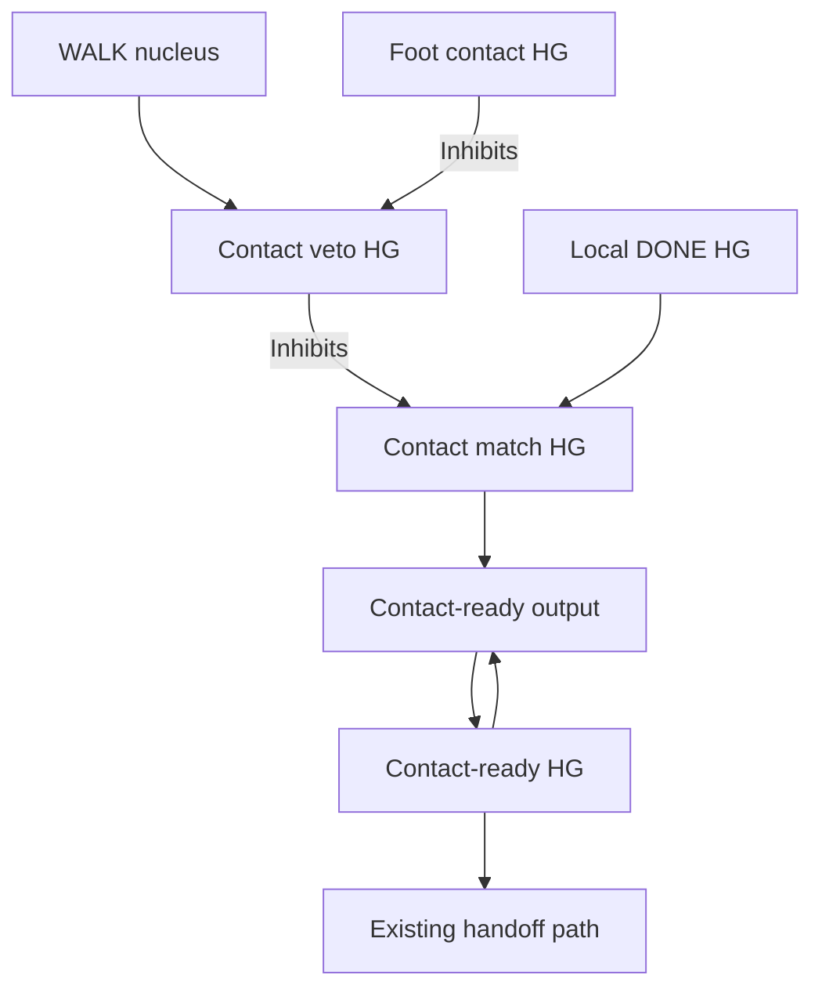

# Foot contact in the neural loop

Each foot has one Webots bumper TouchSensor. Its existing distal collision pad
is the sensing surface; the duplicate parent collider is removed. The pad's
shape and location and the original forearm mass/inertia are preserved. Each
bumper now has a `Physics { density -1 mass 0.01 }` body. Webots attaches it to
the dynamic forearm with a fixed joint, so pad collisions transmit supporting
forces to the leg. This adds 10 g per pad, 40 g total. A kinematic child bumper
can detect overlap without supporting the leg; it is unsuitable for this
load-bearing foot pad. A bumper reports 1 for collision and 0 otherwise;
it does not report supported weight or ground force.

| Leg | Webots device | Input population | Input neurons |
| --- | --- | --- | --- |
| Front left | `front left foot touch` | `FOOT_FL_CONTACT` | 4 |
| Front right | `front right foot touch` | `FOOT_FR_CONTACT` | 4 |
| Rear left | `rear left foot touch` | `FOOT_RL_CONTACT` | 4 |
| Rear right | `rear right foot touch` | `FOOT_RR_CONTACT` | 4 |

The four identical bits in each input encode that foot's single measured state.
They are four neurons, not four independent sensors or force levels. This adds
16 sensory neurons, bringing the complete graph to 77 external neurons across
12 named inputs and 551 neurons in total. The compatible builder's allocation
is in [RESOURCE_CHECK.json](RESOURCE_CHECK.json).

## Return first, then contact-qualified handoff

The existing return pathway commands extension without waiting for contact.
That movement must remain available to bring a raised foot toward the floor.
The new gate qualifies only the handoff to the next leg or macro phase.

WALK supplies the veto's positive reference. In the absence of fresh contact
evidence, the veto suppresses the match population. Contact inhibits the veto,
allowing local DONE activity through. Contact alone has no positive route into
the match population. DONE alone remains vetoed. This is a local suppression
and disinhibition circuit, not an arithmetic NOT or a half-unit AND recipe.

| Population / connection | Operating point | Role |
| --- | --- | --- |
| `FOOT_*_CONTACT_HG` | High-gamma T10, 4 neurons | Relays measured contact |
| `LEG_*_CONTACT_VETO_HG` | High-gamma T10, 1 neuron | WALK-driven veto |
| Contact HG → veto | Inhibitory strength 64 | Removes veto when contact arrives |
| `LEG_*_CONTACT_MATCH_HG` | High-gamma T10, 1 neuron | Receives local DONE |
| Veto → match | Inhibitory strength 64 | Blocks unqualified return |
| `LEG_*_CONTACT_READY` | Bistable output, 1 neuron | Captures the qualified event |
| `LEG_*_CONTACT_READY_HG` | High-gamma T10, 1 neuron | Retains the event and drives handoff |

These small one-neuron gates relay the one-neuron return state. They do not
drive reflex motors. Each existing tilt reflex still has 24 high-gamma T5
neurons and its separate fast motor output. Inhibitory strengths are multiples
of the SDK's calculated reference, not percentages or TNorm values.

For a front leg, CONTACT_READY_HG excites its existing HANDOFF_BETA T3, which
recruits the diagonal rear MOVE_HG. For a rear leg, CONTACT_READY_HG excites
the phase's existing MOTOR_FEEDBACK_HG. A still sequences FR then RL; B still
sequences FL then RR. Contact does not select a different gait.

## Retention and clearing

Once captured, CONTACT_READY and its HG retain the handoff event through brief
later contact gaps. This is event memory, not a continuous support guarantee.
Local MOVE_HG, the opposite/support phase and STOP/REST inhibit MATCH, READY
and READY_HG at strength 64. This clears a previous cycle's confirmation before
reuse. STOP/REST also clears the contact veto. No global brain reset occurs.

The sensory relay is not a latch. Every transmitted nonzero sample is a new
input event. Input transport can delay contact qualification; the controller
never holds motor frames or adds an ACK while waiting for that evidence.

All contact connections are static. The four release-feedback connections keep
STDP3/LTP and the four regular support-drive connections keep STDP3/LTP. Every
reflex connection remains static, including its excitation of regular Beta.

## Inspect a run

The periodic console line prints raw `contacts` and active `contact_ready`
readouts. `observations.jsonl` contains every measured `foot_contact` and its
encoded `contact_inputs`. `contact-inputs.jsonl` contains accepted transmitted
captures, including capture age and native output step. Unsent captures can be
replaced by newer readings; the two logs make that visible.

In telemetry, follow contact HG → veto → match → ready → handoff. While standing,
planted pads should read 1. A raised pad should read 0. If a foot has DONE=1 but
READY=0, inspect its physical contact and the gate; do not add a host timer to
force the next phase. Sensors remain available in `rhythm` mode while actuators
hold neutral and tilt evidence is suspended. Explicit simulator recovery
suspends contact input until recovery completes.

Contact during return qualifies the handoff even if that foot never left the
floor. This design does not require an airborne transition, measure backward
propulsion, estimate the centre of mass, or confirm that another leg has been
unloaded. Those are distinct observations and goals.

The Webots bumper API and collision requirements are documented in the
[official TouchSensor reference](https://github.com/cyberbotics/webots/blob/R2025a/docs/reference/touchsensor.md).
The physical attachment follows Webots' [TouchSensor implementation](https://github.com/cyberbotics/webots/blob/R2025a/src/webots/nodes/WbTouchSensor.cpp)
and [physical bumper example](https://github.com/cyberbotics/webots/blob/R2025a/projects/samples/devices/worlds/bumper.wbt).
The sensor must own the collider that actually meets the floor. Tests verify
the packaged geometry and SDK path; physical collision readings still need the
Webots/device run described in [TESTING.md](TESTING.md).
