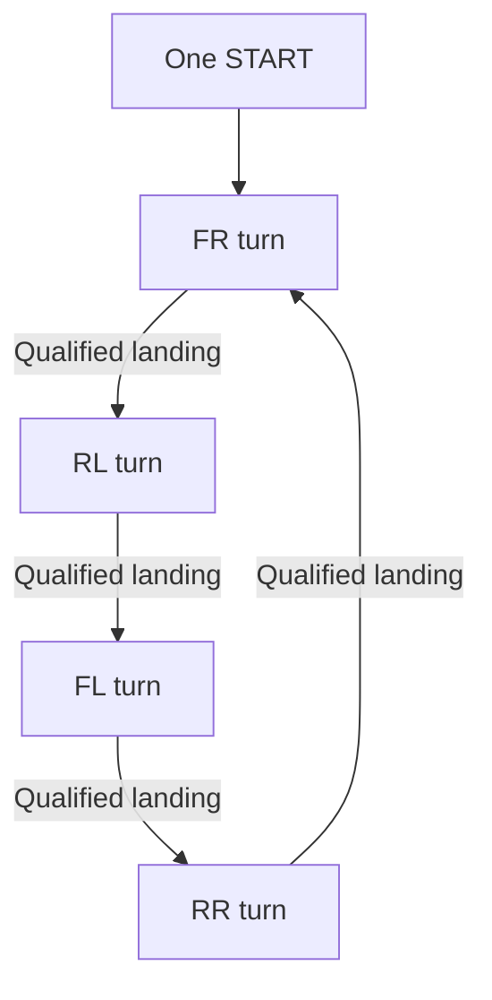
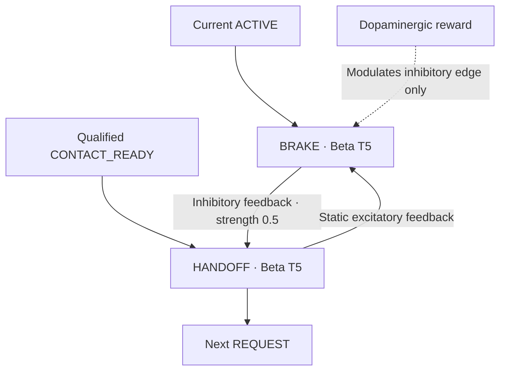

# Four turns, local movement, learned inhibition

One START seeds STEP_FR_REQUEST. Each turn has retained REQUEST, ACTIVE and
STANCE outputs with high-gamma T10 helpers. ACTIVE recruits that leg's motor
primitive and clears its stance; next ACTIVE restores the previous leg's stance.
The next REQUEST clears the previous ACTIVE while the next ACTIVE is being
recruited. The fixed order is FR → RL → FL → RR → FR. The controller never picks
the active leg.



Each arrow includes a local handoff Beta and the next request capture. STOP/REST
inhibits all turn, motor and retained sensor-event states. A new START seeds FR.

## Local motor goal

ACTIVE_HG recruits MOVE_HG directly for front legs. Rear legs retain a Beta T3
(two-neuron) drive before MOVE_HG, preserving their local motor input rhythm and
width. This is a local drive, not a front-output → rear-output shortcut.
MOVE recruits the existing motor Betas and PUSH_HG in parallel. The push briefly
extends the knee. Hip Beta recruits retained SWING_READY; readiness clears push
and allows flexion. Knee flexion output recruits RETURN_BETA T3. RETURN directly
excites final extension and clears knee flexion; retained DONE keeps the return
available and ends MOVE. Local stance recruits the regular support Betas.
The actuator calibration and independent reflexes are unchanged.

DONE means the return pathway has become active. It is **not measured completion
of an angle or stroke**. Actual contact supplies the additional physical evidence.

## Qualifying the event

A foot reading is encoded on CONTACT and AIR rails (four neurons each). AIR
passes its local neural veto only during the leg's ACTIVE turn and sets AIR_SEEN.
CONTACT passes two local vetoes only when AIR_SEEN and DONE have removed them.
It then sets CONTACT_READY. This combines current contact with retained lift-off
and motor-return evidence. A planted foot cannot cascade all four turns.

This uses the guide's shallow positive-evidence-plus-inhibitory-veto pattern.
It is a local temporal conjunction, **not a claim of a canonical arithmetic Delta
AND**. The gate's temporal behavior was checked in the local native harness.
Each request, stance and STOP/REST clears the appropriate event memories.
Sensory vetoes remain driven by their input during REST, preventing unqualified
evidence from leaking across START. See [CONTACT.md](CONTACT.md).

## Place plasticity before the handoff

For each leg, the current ACTIVE drives BRAKE_BETA before CONTACT_READY arrives.
CONTACT_READY drives HANDOFF_BETA. Its inhibitory input therefore affects the
recruitment of the next turn instead of merely resetting an already finished one.



The dotted reward arrow denotes modulation of the inhibitory connection, not an
excitatory connection into BRAKE. Both Betas have two constructed neurons.
Their returned edges explicitly use `role="feedback"`; the SDK calculates
construction from the public design fields.

| Plastic source | Plastic target | Type | Rule in learning design | Initial strength |
| --- | --- | --- | --- | ---: |
| STEP_FR_BRAKE_BETA | STEP_FR_HANDOFF_BETA | Inhibitory feedback | STDP3 / LTP | 0.5 |
| STEP_RL_BRAKE_BETA | STEP_RL_HANDOFF_BETA | Inhibitory feedback | STDP3 / LTP | 0.5 |
| STEP_FL_BRAKE_BETA | STEP_FL_HANDOFF_BETA | Inhibitory feedback | STDP3 / LTP | 0.5 |
| STEP_RR_BRAKE_BETA | STEP_RR_HANDOFF_BETA | Inhibitory feedback | STDP3 / LTP | 0.5 |

The static design omits `rule`, `reward` and `reward_type` on these same edges.
All other edges are identical. Every excitatory path, sensory gate, reflex,
command latch and STOP connection is fixed. No LTD rule is present. A common
reward can modulate four distinct local eligibility histories; there is no
controller assignment of credit to a selected leg.

LTP is the requested reward mode. Its actual update follows the SDK's signed
eligibility; it is not a promise that every reward increases a weight. These
connections can change inhibition and handoff timing. This does not calibrate
a touch sensor or measure load, and it does not guarantee better locomotion.

## Initial inhibitory operating point

We tested fixed multipliers 0.25, 0.5, 0.75, 1, 1.5, 2 and 4 with the full graph
and the same synthetic foot fixture. First FR landing readiness appeared at
native harness step 171. The next RL turn began at:

| Inhibitory multiplier | Next RL step | Steps after CONTACT_READY |
| ---: | ---: | ---: |
| 0.25 | 184 | 13 |
| **0.5** | **185** | **14** |
| 0.75 | 186 | 15 |
| 1 | 187 | 16 |
| 1.5 | 199 | 28 |
| 2 | 199 | 28 |
| 4 | 214 | 43 |

BRAKE first fired at step 129 in each case, before landing readiness. This
supports choosing 0.5 as a responsive, relatively light baseline. It is not an
optimized physical weight or a guaranteed linear response. Harness steps are
not Webots milliseconds. The sweep kept weights fixed; it does not demonstrate
STDP3 updates. Full results and limits: [HANDOFF_SWEEP.json](HANDOFF_SWEEP.json).

## Rhythm and population choices

- **Handoff/brake: Beta T5, two neurons each.** Moderate neural recruitment with
  a measured inhibitory influence before the next request.
- **Contact/AIR relays and vetoes: high-gamma T10, four neurons each.** These
  transfer binary sensory evidence. They do not produce the corrective burst.
- **State helpers: high-gamma T10, one neuron each.** They retain one-neuron
  diagnostic/control states with explicit clearing; they are not motor reflexes.
- **Regular motor Betas: T5.** Their widths follow their incoming populations:
  knee extension is 24; other regular motor Betas are 2 or 4. The local motor
  construction is preserved rather than retuned for the cascade.
- **Reflex: high-gamma T5, 24 neurons per corner.** Direct fast output plus fixed
  excitation into the regular 24-neuron knee-extension Beta T5. Reflex recovery
  uses Beta T3 populations of 2 then 4 neurons.
- **Reward: 10 input → 10 high-gamma T10 → 17 dopaminergic T3 neurons.**

TNorm is a public SDK construction parameter, not an arbitrary delay in ms or
an actuator speed. Neuron counts above are verified construction results.
See [RESOURCE_CHECK.json](RESOURCE_CHECK.json) for every population.

To author another fixed strength, explicitly regenerate, inspect and rebuild:

```bash
python design_brain.py --handoff-inhibition 0.75
ab design --brain brain.abdesign.json --env .env
```

`--learning` adds the four learning annotations. This authoring command overwrites
the root design; it is never called by install or run. Save Canvas edits first.
