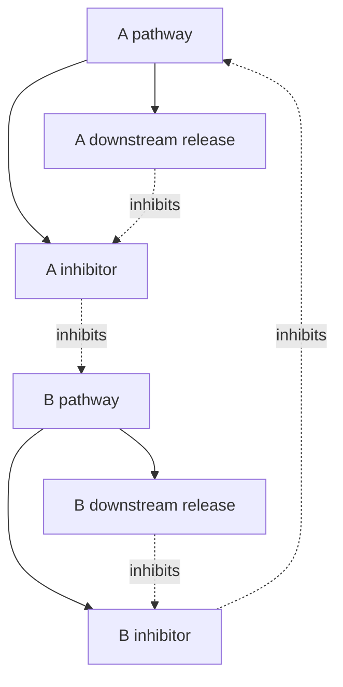

# Reciprocal disinhibition and four leg motor cortices

Construction references: Introductory Guide to Building an Artificial Brain,
chapters 05–06, 08 and 13–14, and the Artificial Brains Agent Guide.
Only public SDK relationships appear in this project.

## External contract

| Input | Neurons | Meaning |
| --- | --- | --- |
| WALK_START | 1 | One request to enable walking |
| WALK_STOP | 1 | One request to inhibit walking; also sent at startup |
| TRANSPORT_ACK | 1 | Acknowledgement stimulus accompanying that request |
| GAIT_REWARD_IN | 1 | Binary physical outcome reward while learning |
| TILT_ROLL_NEG / TILT_ROLL_POS | 12 each | Measured roll beyond the negative/positive deadband |
| TILT_PITCH_NEG / TILT_PITCH_POS | 12 each | Measured pitch beyond the negative/positive deadband |

Live inputs are one-step events. An atomic command event includes START or STOP
and ACK. Waiting in Python does not retain the command input on the device.
The graph itself captures the event and carries the request through the switch.
No phase, clock, target or joint-progress inputs are added.

## Capture a request, then retain the goal

START → High-Gamma T10 → START_REQUEST (bistable output) → START_REQUEST_HG
(High-Gamma T10). The helper reinforces START_REQUEST, excites WALK_ENABLED,
and inhibits REST_ACTIVE and REST_NUCLEUS. Its continuing neural activity can
clear the old REST state and recruit WALK even though the input event has ended.

WALK_ENABLED → WALK_NUCLEUS (High-Gamma T10) reinforces WALK_ENABLED and supplies
WALK_DRIVE (Theta T2.01). Once WALK_NUCLEUS recruits, it clears START_REQUEST and
START_REQUEST_HG. The retained goal then supplies both phase T1 populations equally.

STOP has the same structure through STOP_REQUEST and STOP_REQUEST_HG to REST.
Each incoming command cue also clears the opposite request and its helper.
The initial cue relay is not inhibited by the currently active goal: an existing
REST state must not prevent a new START request from being captured.

| State | Retaining path | Clearing paths |
| --- | --- | --- |
| START_REQUEST | START_REQUEST_HG → START_REQUEST | WALK_NUCLEUS or incoming STOP cue |
| STOP_REQUEST | STOP_REQUEST_HG → STOP_REQUEST | REST_NUCLEUS or incoming START cue |
| WALK_ENABLED | WALK_NUCLEUS → WALK_ENABLED | STOP_REQUEST_HG and REST_NUCLEUS |
| REST_ACTIVE | REST_NUCLEUS → REST_ACTIVE | START_REQUEST_HG and WALK_NUCLEUS |

WALK and REST nuclei inhibit each other's nucleus and output. REST also inhibits
WALK_DRIVE, startup bias, phase states, and local motor populations and outputs.
STOP_REQUEST_HG directly opposes phase T2, Beta, inhibitor and release while REST
recruits. Removing excitation alone is not a stop for bistable motor outputs.

The adapter observes WALK/REST to confirm the transition; it does not simulate
request retention or choose a motor phase. All request and goal paths stay static.
The two request outputs and two high-gamma helpers use four neurons and require
no repeated external command. The [isolated command check](COMMAND_CHECK.json) exercises
single-event STOP, START and restart. Full body coordination still needs a live run.

## Each phase releases the other

The functional arrangement is symmetric:



A's downstream release inhibits **A's own inhibitor**. Because that inhibitor
suppresses B, this releases B. B mirrors the arrangement. The inhibitory population
belongs to its source phase; its targets lie in the opposite phase.

| Stage | Rhythm | TNorm | Role |
| --- | --- | --- | --- |
| T1 | Theta | 3 | Phase preparation |
| T2 | Theta | 2.01 | Recruit expression and inhibitor; prepare the opposite T1 |
| BETA | Beta | 5 | Recruit local motor populations and downstream release |
| INHIBITOR | Beta | 5 | Suppress the opposite phase and its motor outputs |
| RELEASE | Beta | 3 | Inhibit this phase's INHIBITOR and clear its readout |

Exact paths: T1 → T2 → BETA → phase output, T2 → INHIBITOR, and BETA → RELEASE.
A_T2 → B_T1 and B_T2 → A_T1 are feedback connections. Each T1 also has its ordinary
WALK_DRIVE source; both immediate sources are Theta T2.01.

The cross-inhibitor targets the opposite T2, BETA, INHIBITOR and RELEASE, and clears
their diagnostic outputs plus the local motors associated with that opposite phase.
Opposite T1 remains available for preparation. Clearing the opposite RELEASE is
intended to make that side's inhibitor available on a subsequent cycle.

RELEASE inhibits its own INHIBITOR and its readout only. It does not directly
stop its own motor phase. The opposite inhibitor is responsible for ending that
phase when the other side takes over. There is no additional direct phase-Beta
cross-veto that could keep the opposite phase blocked after disinhibition.

The guide supplies Theta T3 → Theta T2.01 → Beta T5 and Beta T5 → Beta T3
relationships. Routing the latter back to a separate cross-inhibitor is the
composition being tested here. Wiring alone does not prove alternation: recruitment,
release, recovery and any overlap need to be observed across repeated cycles.

## Initial inhibition and learning

Gait cross-inhibition and downstream release begin at `strength=1.0`, the SDK's
inhibitory reference. Command and REST clearing remain static at `strength=4.0`.
Startup bias, local actuator antagonists and ACK reset remain static at reference
strength. TNorms and the source-to-target relationships above are unchanged.
Strength sets initial inhibitory intensity; TNorm is not a strength control.

There are **66 STDP3 inhibitory connections**, bound to the single dopaminergic
population `GAIT_REWARD` with `reward_type="LTP"`:

| Paths | Connections | Why learn here |
| --- | ---: | --- |
| RELEASE to its own INHIBITOR and inhibitor readout, both phases | 4 | Adjust release of the opposite phase |
| Each INHIBITOR to opposite phase populations and readouts | 14 | Adjust competing phase suppression |
| Phase veto to local motor populations and outputs (eight paths use local knee-extension relays) | 48 | Adjust suppression through to actuator expression |

The population and output vetoes learn together as a policy; their individual
weights are not tied. Leaving a parallel veto fixed at strength 4 would allow it
to dominate a weaker learned path. The learning rules themselves add no extra OPUs or inputs.
Excitatory preparation, command reinforcement, STOP and ACK are not plastic.

The reward path is `GAIT_REWARD_IN → GAIT_REWARD_RELAY` (High-Gamma T10)
`→ GAIT_REWARD` (dopaminergic T3). Plastic edges reference that population through
SDK metadata. There are no ordinary reward-to-phase or reward-to-motor edges.
The actual public SDK declaration is:

```python
brain.connect(
    "PHASE_A_RELEASE", "PHASE_A_INHIBITOR", "inh",
    strength=1.0, role="feedback",
    rule="STDP3", reward="GAIT_REWARD", reward_type="LTP",
)
```

STDP3 combines local activity eligibility with reward modulation. LTP follows the
eligibility direction; LTD reverses it. LTP on an inhibitory edge does **not** mean
that every positive reward must make inhibition stronger. The network and reward
timing determine the eligible updates. Zero reward is absence of reward, not a
negative punishment. We do not invent a learning-rate parameter or clamp learned
weights in Python.

The learning signal cannot select A/B, create a missing oscillation, or rescue a
permanently silent network by itself. First inspect whether the neural circuit
recruits, releases and produces varied movement. [Testing](TESTING.md) separates
this from evidence of improvement due to learning.

Change the named settings in `design_brain.py`, regenerate explicitly, inspect,
and rebuild to test another design. `python design_brain.py --static` removes
learning metadata while keeping topology, initial strengths, TNorms and I/O.
This overwrites the saved design; preserve Canvas edits first.

## A starts through a temporary bias

START_REQUEST_HG also recruits START_A_BIAS → High-Gamma T10. The helper inhibits B's T2,
BETA and INHIBITOR. A's INHIBITOR clears the bias once it recruits; STOP and REST
also clear it. The bias gives A an initial opportunity without extra continuing
excitation to A, a controller timer or another external input. Observe its clearing
latency and first-phase recruitment rather than assuming they are guaranteed.

## Four local motor cortices

A and B are coordinated phases, not individual legs or the robot's left/right sides.
Four named columns appear below the phase core in the Designer:

| Leg group | Short output prefix | Swing phase | Support phase |
| --- | --- | --- | --- |
| FRONT_LEFT | FL | A | B |
| FRONT_RIGHT | FR | B | A |
| REAR_LEFT | RL | B | A |
| REAR_RIGHT | RR | A | B |

Each leg has ABD, HIP and KNEE actuators, each with POS and NEG Beta T5 populations
and output neurons: 4 × 3 × 2 = **24 local motor populations**. The complete path is
Theta T3 → Theta T2.01 → phase Beta T5 → local motor Beta T5 → motor output.
The ordinary Beta T5 → Beta T5 relays follow the guide's active-state relationship.
Knee extension adds a high-gamma T3 phase relay so gait and reflex can both
excite its Beta through compatible immediate source rhythms.

Each local Beta inhibits its opposing local Beta and output. The opposite phase's
INHIBITOR also clears the population and output. For knee extension, a local
high-gamma veto relay carries these two inhibitory paths; the reflex can inhibit
that local relay without affecting another leg. REST clears both directions.
Preparation is shared at phase level; there is no extra Theta pair per actuator.

Hip/knee POS is recruited by the leg's swing phase and NEG by its support phase.
Abduction is mirrored: swing uses NEG on the left and POS on the right. These
connections propose diagonal coordination, a trot candidate. They do not establish
an effective foot trajectory or stable locomotion by themselves.

## Readouts and budget

Phase, inhibitor and release outputs are diagnostics. The adapter never uses them
to select a phase or move a joint. Only the 24 local motor outputs actuate the body.
Readouts have explicit clearing connections but remain bistable populations;
they are not a complete view of the OPUs. Compare them with population telemetry.

The saved graph contains 60 OPUs, 40 one-neuron outputs and eight input populations:
108 populations and 385 connections. Construction reports 922 total neurons,
including 52 external neurons, and 1,123,584 bytes (about 1.07 MiB) of matrix storage. Other image data also uses the
32 MiB budget. The device Build remains authoritative.

ACK remains input → High-Gamma T10 → output → separate High-Gamma T10 reset,
with inhibition back to its output. It has no behavioral connections.

Output-to-new-helper connections use ordinary excitation to supply the helper's
construction path. Returns into already constructed phase/motor OPUs use the
feedback role. Reinforcement into outputs is ordinary excitation because the
public feedback role targets OPUs. No dummy external input is added.

## Local support reflexes

Four 12-neuron tilt populations feed four independent high-gamma T3 reflexes.
Each reflex has 24 neurons; its self-reset, recruited by the extension Beta,
has 28. Local reflex feedback bridges sensory-sample gaps until that reset acts. Reflex excitation enters the existing
extension Beta, which has 28 neurons after combining the phase and reflex sources.
Flexion's Beta and output receive local inhibition. A 12-neuron local relay carries
the gait's extension veto; the reflex inhibits it to release its own extensor.
Two shared high-gamma relays adapt phase excitation to the same immediate rhythm.
ACTIVE has no outgoing connections. See [REFLEX.md](REFLEX.md).

The phase core, command paths, motor TNorms and 66 STDP3/LTP inhibitory relationships
remain. Eight knee-extension learning paths now originate from local veto relays;
four phase-to-extension excitatory paths pass through the shared high-gamma relays.
The builder recalculates the affected populations and connections. Build this graph
before Run; old compiled state and learned weights are not interchangeable.
