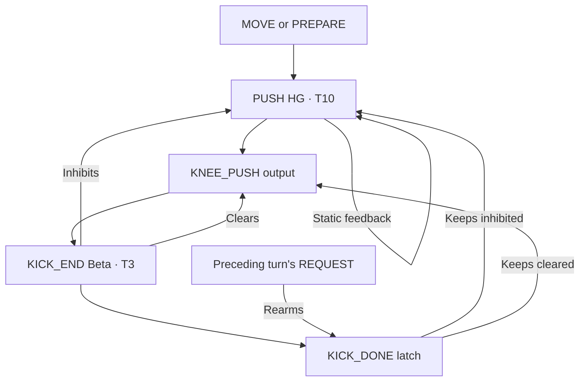

# A persistent request that produces one kick

Each leg's MOVE_HG and PREPARE_HG recruit PUSH_HG. The preceding leg's return
sets PREPARE early, while this leg is still grounded. PUSH_HG has a static
excitatory self-feedback edge: the request can remain active until its kick
output recruits termination. STANCE and hip SWING_READY do not cancel this request.

KICK_END_BETA has two neurons. It inhibits PUSH_HG and KNEE_PUSH at strength 64,
and sets KICK_DONE. KICK_DONE is a one-neuron output retained by a one-neuron
high-gamma T10 helper. That helper keeps the push relay and output suppressed
while the original PREPARE/MOVE drive remains active. This makes a bounded kick
rather than continuous extension or repeated pulses from a held request.

The preceding leg's REQUEST clears KICK_END_BETA, KICK_DONE and its helper at
strength 64, before that leg's RETURN prepares this leg again. Clearing from
STANCE or held PREPARE would continuously erase completion and retrigger kicks;
those reset edges are deliberately absent. STOP/REST clears all kick states.
DONE retains its existing local push-clear as well.

Push relays are high-gamma T10: three neurons in each front leg and four in each
rear leg. Their existing MOVE and PREPARE inputs determine these widths. The
new feedback and termination connections are static. PUSH inhibits the local
knee-flexion output until it ends; hip readiness still drives the ordinary
extension veto, but cannot terminate a kick before its output fires.

A local FLEX_WAIT_HG (high-gamma T10, one neuron) is driven by ACTIVE. It
inhibits knee flexion until the existing extension veto inhibits FLEX_WAIT.
This prevents kick completion from releasing flexion before retained extension
has been vetoed. STANCE and STOP clear this helper. All these edges are static;
there is no new sensory input or controller delay.

The kick uses the existing target, −0.12 rad from neutral at up to 3 rad/s.
Normal flexion is +0.35 rad at 1.5 rad/s. Actual neural knee-flexion output
recruits RETURN_BETA T3, which directly excites KNEE_NEG, clears KNEE_POS and its
extension veto, and sets retained DONE. Final extension remains −0.08 rad at
1.5 rad/s. Controller targets, speeds and reflexes are unchanged.

KICK_DONE confirms neural output activity, not a completed physical stroke or
measured weight transfer. The contact circuit still requires lift-off, return
activity and measured landing before the next turn. A foot that never lands can
still stall the cascade; this circuit does not fabricate touchdown evidence.
See [CONTACT.md](CONTACT.md) and [VALIDATION.md](VALIDATION.md).
