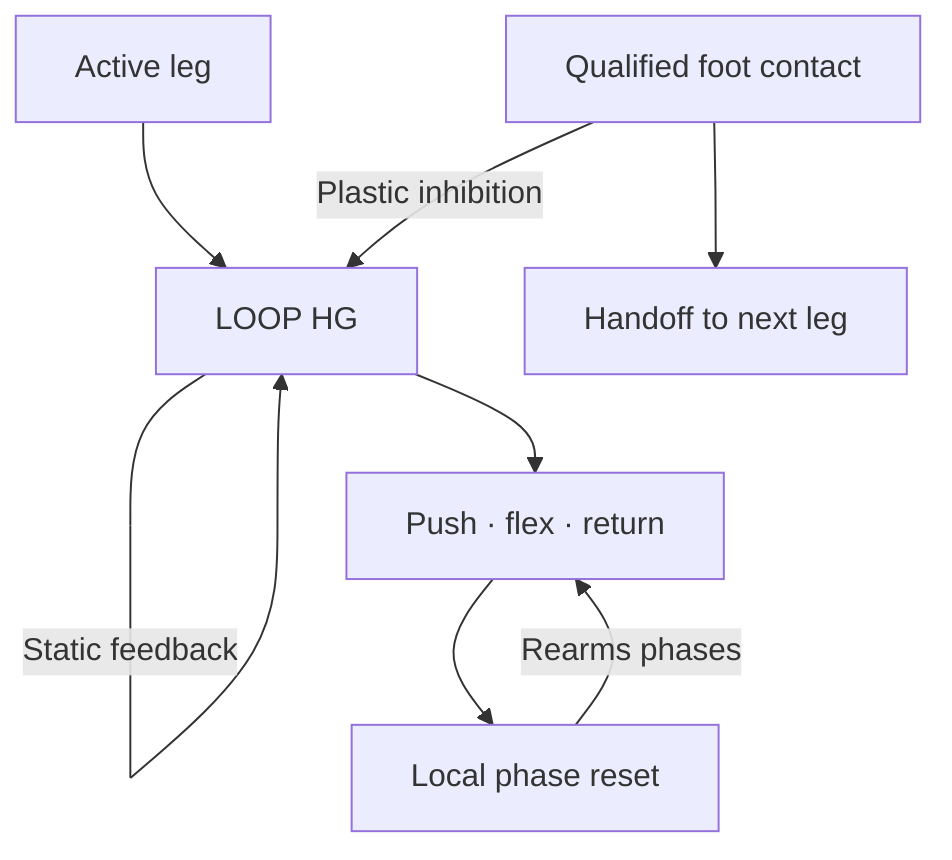

# The foot sensor ends the local leg loop

Each leg has a recurrent **LEG_*_LOOP_HG**. Its drive recruits MOVE and the
existing push → flexion → return primitive. A completed motor pulse does not
inhibit this recurrent drive. If landing is still missing, local neural phase
reset lets the same leg try again. The next leg can prepare while it waits.

**Only CONTACT_READY_HG inhibits LOOP_HG during ordinary WALK.** That local
inhibitory feedback uses STDP3, GAIT_REWARD and LTP, initially at strength 16.
The four existing
BRAKE_BETA → HANDOFF_BETA learning paths remain. All excitatory connections
and all reflex paths stay static. Global STOP/REST clears the recurrent loops
through fixed strength-64 inhibition.

Contact is qualified by the existing local gate: the foot must have left the
floor during its active turn, return must have been recruited, and the sensor
must report contact. Initial planted contact must not stop an attempt before it
can lift. This qualification stays neural; the controller sends measured CONTACT
and AIR populations only. Silence is not interpreted as lift-off.

CONTACT_READY remains latched through stance, so residual rear-drive activity
cannot restart a completed leg loop. That leg's next REQUEST clears the old
landing evidence and rearms the loop. STOP/REST also clears the evidence.

## The loop and its phases are distinct

LOOP_HG is high-gamma T10: one constructed neuron in front, two at the rear.
It drives the unchanged MOVE_HG. PUSH_HG is now a pulse branch without its own
self-feedback. KNEE_PUSH → KICK_END_BETA ends that individual push and retains
KICK_DONE; neither population inhibits LOOP_HG. DONE ends MOVE for the return
phase, leaving the recurrent LOOP_HG available for another attempt.

DONE_HG recruits RETRY_BETA T3 (two neurons), then RETRY_CLEAR_BETA T3 (four).
The second stage clears local DONE, RETURN, SWING_READY and KICK_DONE states.
This allows the persistent LOOP_HG to recruit another motor attempt. The clear
stage inhibits its own upstream Beta, and new PUSH activity inhibits the clear
stage. These are static phase-reset connections. They never inhibit LOOP_HG or
erase the remembered lift-off/contact evidence. Qualified contact and STANCE
clear the retry stages; STOP/REST clears all local state.

FLEX_WAIT_HG retains the existing interlock: knee flexion waits for the ordinary
extension veto. Independent corrective reflexes retain their direct fast output
and fixed connection into the regular extension Beta.

## Actuation and physical evidence

Motor targets and speeds are unchanged in this package. A push commands −0.12
rad from neutral at up to 3 rad/s; regular flexion commands +0.35 rad and return
−0.08 rad at 1.5 rad/s. Repetition is generated inside the brain, without ACK,
periodic START commands, a host gait clock or a maximum run duration.

Repeated attempts are not proof of successful weight transfer. A joint can
reach its configured angle while the foot remains airborne. The current logs
therefore include raw center of mass, foot centers, motor torque, measured joint
positions, targets and touch states. These measurements are for diagnosis only;
they do not choose an action or add external neural inputs. See [PHYSICS.md](PHYSICS.md).
