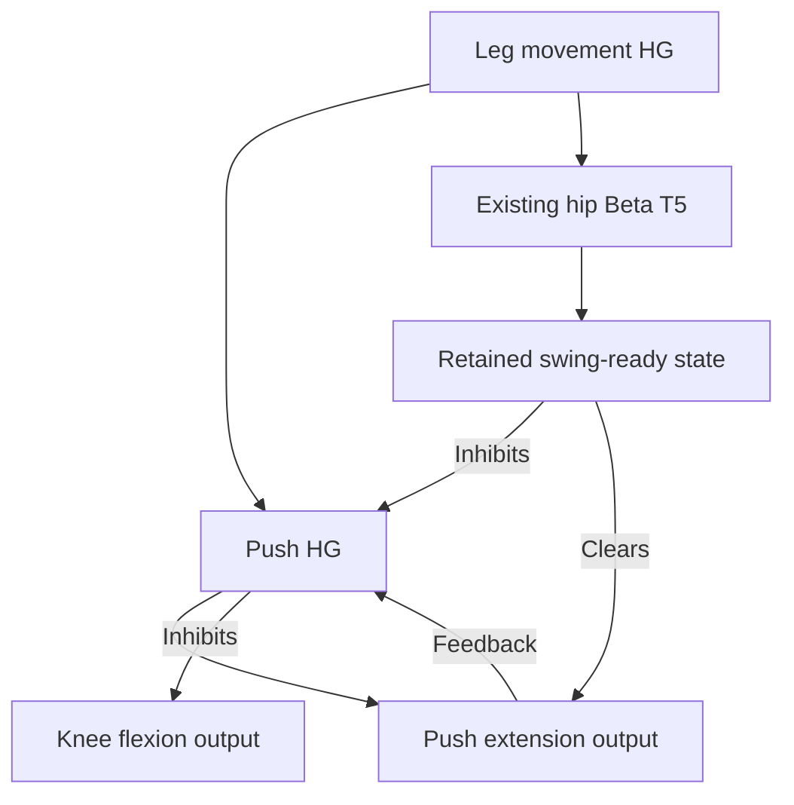

# Push before swing

The leg about to move first requests a small extension against the ground.
Its flexion output is held off while the ordinary motor pathway builds activity.
A downstream readiness state clears the push so knee flexion can follow.
The intent is to initiate unloading before lifting; neural readiness does not
measure that weight actually transferred.

PUSH_HG receives the same local movement drive as the gait Betas. It is a small
high-gamma T10 relay: one neuron for each front leg, two for each rear leg.
Its output is calibrated to **−0.12 rad at up to 3.0 rad/s**, relative to neutral.
The push output feeds back into PUSH_HG so gaps in upstream activity do not
release flexion while the push command remains latched.

HIP_POS_BETA excites SWING_READY. That output and SWING_READY_HG retain readiness
until local return or the opposite macro phase clears them. SWING_READY_HG
inhibits PUSH_HG and clears KNEE_PUSH at strength 64. Retention prevents repeated
pushes during the same movement. Hip and abduction commands may begin while
this preparation finishes; knee flexion follows push clearing. There is no
Python delay or requirement to reach a target before advancing.

The return starts from actual **KNEE_POS output**, through RETURN_BETA T3 into
DONE. DONE/DONE_HG retain the return state, end this leg's movement and excite
its ordinary support Betas. This lets the support command persist while the
next leg moves. The opposite macro phase clears the local state for reuse.

| Macro state | First movement | Following movement |
| --- | --- | --- |
| A | Front-right push, swing, return | Rear-left push, swing, return |
| B | Front-left push, swing, return | Rear-right push, swing, return |

A front leg's DONE_HG also excites HANDOFF_BETA T3. That pathway recruits the
rear partner's MOVE_HG after front return has begun. Rear DONE_HG recruits the
macro handoff pathway. The front's reflex output and ordinary extension output
are not handoff sources, so a corrective reflex cannot itself request a rear
step. This is sequencing of motor activity; there are no foot-load inputs or
claims of confirmed touchdown.

The tilt reflex stays independent. It can request the larger **−0.22 rad** fast
extension of its own leg and inhibit flexion. If push and reflex extension are
both active, the adapter uses the larger excursion instead of adding them.
Their neural clearing paths remain separate. See [REFLEX.md](REFLEX.md).

The local checks test push-before-flexion, no overlapping leg flexion, front
support output at rear swing onset, stopping and reuse after restart. Actual
unloading, ground contact, body motion and balance require the Webots/device run.
