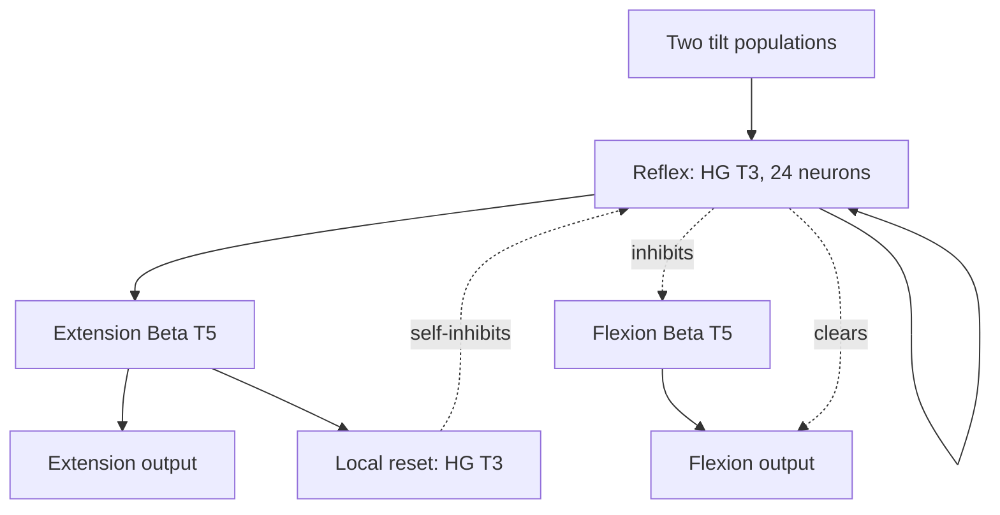

# A support reflex that recruits the motor Beta

Each leg has its own high-gamma support reflex. It excites that leg's knee
extension Beta and inhibits both its knee flexion Beta and flexion output.
The extension Beta then drives the extension output. The reflex has no
excitatory shortcut to that motor output and never targets another leg.

## Inputs and population sizes

There are still four named tilt populations. Each contains **12 neurons**.
A channel publishes twelve ones when its physical measurement crosses the
signed deadband, and twelve zeros otherwise. This represents one measurement
with a population; it does not add twelve sensors or compute a leg command.
The threshold remains 0.15 rad, approximately 8.6 degrees.

| Reflex | Excitatory sensory populations |
| --- | --- |
| Front-left | Negative roll + positive pitch |
| Front-right | Positive roll + positive pitch |
| Rear-left | Negative roll + negative pitch |
| Rear-right | Positive roll + negative pitch |

Webots ENU and this Spot model use local +X forward, +Y left and +Z up.
Negative roll lowers the left side; positive pitch lowers the front. The IMU
has no additional rotation. Check signs if changing the model or its IMU.

Each reflex receives two 12-neuron populations and constructs with **24 neurons**.
Its reset has 28 neurons, constructed from the extension Beta. Both use **high-gamma T3**. There are 48 tilt
neurons plus START, STOP, ACK and reward: **52 external neurons in eight named
populations**. No phase, oscillator or joint-progress inputs are added.

| Population per leg | Rhythm | TNorm | Constructed neurons |
| --- | --- | --- | --- |
| REFLEX_*_HG | High-gamma | 3 | 24 |
| REFLEX_*_RESET_HG | High-gamma | 3 | 28 |
| Existing knee extension motor | Beta | 5 | 28 |
| Existing knee flexion motor | Beta | 5 | 16 |
| Local extension veto relay | High-gamma | 3 | 12 |

The builder derives OPU widths from their sources. Lowering TNorm alone does not
increase the population. T3 is the selected operating point for these relays;
it is not a claim that any incoming activity will remain below saturation.

## Gait and reflex enter the same extension Beta

The building guide requires compatible immediate source rhythms when several
populations excite a rhythmic target. Each phase therefore has one high-gamma T3
relay, `PHASE_A_KNEE_DRIVE_HG` or `PHASE_B_KNEE_DRIVE_HG`.

The extension Beta receives its usual support phase through that relay and its
own reflex directly. Both immediate sources are high-gamma. Their widths are
12 and 24, respectively: 36 source neurons. The constructed extension Beta has
28 neurons. The other motor excitatory paths retain their existing topology.

The shared phase relay receives no reflex inhibition or feedback. Each reflex
acts only on its own leg.

## Give the local reflex access to extension

The gait normally inhibits extension during a leg's swing phase. A local
`REFLEX_*_EXTENSION_VETO_HG` relay carries that inhibition to the same leg's
extension Beta and output. The reflex inhibits this local relay while it
supports the leg. It never inhibits the shared phase inhibitor or another leg.

This is local disinhibition: release this extension path while suppressing its
flexion antagonist. All 66 STDP3/LTP gait inhibitory paths remain represented;
eight knee-extension paths now originate from these four local relays. Their
eligibility therefore belongs to the new local source, and learned weights from
an older installed graph must not be assumed to migrate.

The reflex's inhibition of flexion and of its local extension veto uses
**strength 64**. This was chosen after lower strengths failed the imposed-gait
competition check. Self-reset and STOP/REST retain strength 4. These are
multipliers of the SDK's calculated reference, not percentages of neurons
silenced and not TNorm settings. The live circuit still needs evaluation.

## End the reflex drive locally

`REFLEX_FL_HG` has a local excitatory feedback connection to carry a response
across gaps between sensory samples. The extension Beta recruits
`REFLEX_FL_RESET_HG` after motor activity begins. That reset inhibits its own
reflex and clears the diagnostic `REFLEX_FL_ACTIVE` readout.
ACTIVE has no outgoing connections. No guard, external burst timer or
controller-side motor override maintains the reflex.

Self-reset ends the extra reflex drive. It does not immediately cut the
extension output before the extension Beta can recruit it. Motor output
clearing remains explicit: the local antagonist, the local gait-veto relay
and REST can clear the extension output and oppose its Beta.

Sustained physical evidence can recruit another local burst. When evidence
ends, reflex activity must cease and the gait can regain control. The helper
never resets the entire brain or learned weights. STOP/REST inhibits every
reflex population and readout. Simulator recovery suspends tilt publication
while resetting and settling the body.

Multiple legs can respond together. Forward-left tilt supplies two cues to
front-left, one to front-right and one to rear-left. There is no corner winner,
strict AND gate, or opposite-direction sensory veto.

## Observe the actual motor path

Build the saved graph, wait for READY, then run `ab run -ab --env .env learn`.
Press W. In neuron telemetry, inspect the local reflex, reset, extension Beta,
flexion Beta and extension-veto relay. Inspect the knee outputs and measured
joint motion alongside them. ACTIVE is a bistable diagnostic, not an instantaneous
spike counter or a promise that the leg extended.

The local check in [REFLEX_CHECK.json](REFLEX_CHECK.json) includes the motor
Betas and imposed competing gait activity. It checks extension recruitment,
flexion suppression, cessation after evidence ends and REST. Its explicit
initialization and transport assumptions do not establish device equivalence,
physical support or successful balance recovery.

Each run records tilt bits and publication time in `tilt-inputs.jsonl`, all
received outputs in `native-outputs.jsonl`, and applied outputs plus resulting
body/joint measurements in `observations.jsonl`. Check feedback latency and
queued frames. A foot must reach suitable ground to supply support.

For a comparison, set `reflex.enabled=false` and start a new run with otherwise
matched settings and initial conditions. This disables tilt evidence; it does
not restore an older graph. Changing a sensory deadband needs a new Run.
Changing population widths, rhythm, TNorm or connections requires Design and Build.

Model signs were checked against the bundled `Spot.proto` / `SpotLeg.proto`, the
Webots R2025a [IMU implementation](https://github.com/cyberbotics/webots/blob/R2025a/src/controller/c/inertial_unit.c)
and [hinge defaults](https://github.com/cyberbotics/webots/blob/R2025a/docs/reference/hingejointparameters.md).
