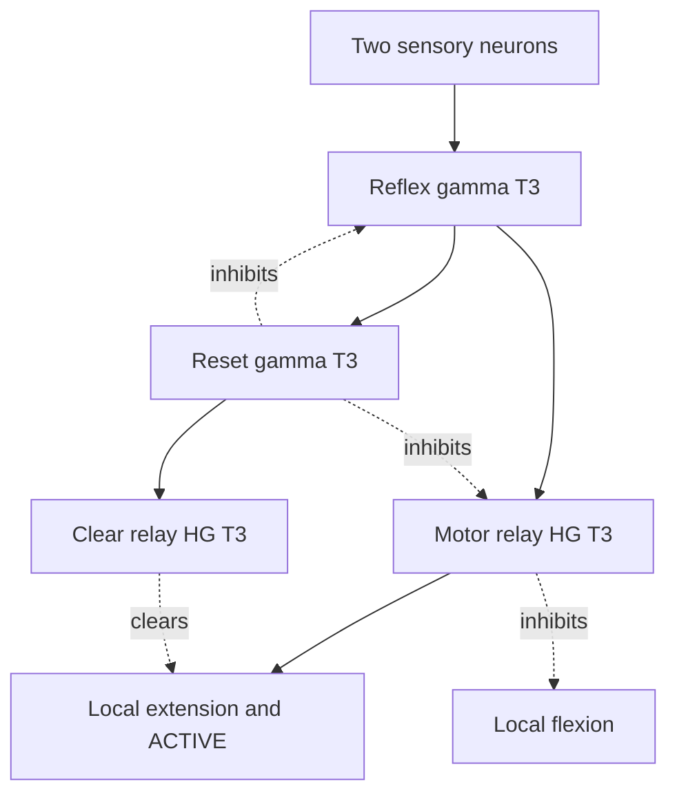

# Independent support reflexes

Each leg has one local support goal: inhibit its own knee flexion, recruit its
own knee extension, then inhibit itself. A reflex never inhibits another leg's
reflex, motors or gait phase. Several legs can provide support together.

The adapter publishes physical tilt evidence. Recruitment, antagonist inhibition
and burst termination belong to the neural graph. There is no Python burst timer,
leg selector, tilt-to-joint formula or extra phase input.

## Four sensory neurons

Roll and pitch are digitized beyond a signed 0.15 rad deadband, approximately
8.6 degrees. Each channel has **one neuron**. This reports direction beyond the
threshold, not tilt magnitude or angular velocity. Gyro measurements are logged.

The world uses ENU: Spot faces local +X, left is +Y, and up is +Z. Its IMU has no
additional rotation. Negative roll lowers the left side; positive pitch lowers
the front. Check these conventions if replacing the model or rotating the IMU.

| Local reflex | Excitatory evidence | External source neurons |
| --- | --- | --- |
| Front-left | Negative roll, positive pitch | 1 + 1 |
| Front-right | Positive roll, positive pitch | 1 + 1 |
| Rear-left | Negative roll, negative pitch | 1 + 1 |
| Rear-right | Positive roll, negative pitch | 1 + 1 |

There are no opposite-direction inhibitory inputs. A leftward tilt supplies both
left legs. A forward-left tilt supplies two cues to front-left, one to front-right
and one to rear-left. Those reflexes remain free to respond independently; the
graph does not select a single winning corner or implement a strict AND gate.

## Local gamma burst and self-inhibition

For front-left, the circuit is:

`REFLEX_FL_GAMMA` recruits `REFLEX_FL_MOTOR_HG`, which excites `FL_KNEE_NEG`
and `REFLEX_FL_ACTIVE`. The motor relay also inhibits `FRONT_LEFT_KNEE_POS_BETA`
and `FL_KNEE_POS`. Inhibiting both the population and its bistable output prevents
an old flexion readout from remaining latched after recruitment stops.

The reflex also recruits `REFLEX_FL_RESET_GAMMA`. That population inhibits the
reflex and its motor relay. It recruits `REFLEX_FL_CLEAR_HG`, which clears the
extension and ACTIVE outputs. Removing excitation alone would not clear a
bistable output. The return into the reflex uses `role="feedback"`.

**ACTIVE has no outgoing connections.** It is a diagnostic readout, not a guard,
an extra drive or a controller-side instruction. There is no three-stage reset
delay. FR, RL and RR repeat this same local structure.

The two high-gamma relays exist because the compatible builder accepts beta or
high-gamma sources at the bistable output boundary, including inhibitory clearing.
A direct gamma-to-output connection is rejected. The reflex and self-inhibition
remain a gamma pair; the output adapters use T3, not T10.

## Choose TNorm from the source relationship

Each reflex receives two one-neuron input populations directly. Construction
produces three neurons in its gamma population; its reset gamma therefore has a
three-neuron source. The motor and clear adapters also construct with three
neurons each. These widths are construction results, not extra external inputs.

All four OPUs in each local reflex use **T3 as a lower starting point**. The
building guide describes T2–3 as a lower operating region and T10 as the upper
boundary where activity can merge or saturate. It does not prescribe one universal
TNorm for this particular input-to-gamma and gamma-to-gamma circuit. T3 must still
be evaluated with actual population activity and the physical response. Frequency,
TNorm and inhibitory strength are different choices.

Local reflex inhibition is static strength **4**. TNorm is not the control for
inhibitory intensity. Changing the neural rhythm also does not increase servo
velocity, torque or permitted position range.

An isolated sensitivity check exercised one- and two-cue stimulation with explicit
initialization and connectivity assumptions. It produced bounded extension
readouts and cleared after evidence stopped. Burst lengths varied from two to
seven modeled steps; there is no fixed pulse-width promise. This check excludes
the gait, learning and body physics. See [scope and results](REFLEX_CHECK.json).

## Interaction with gait and STOP

The reflex targets the existing knee outputs. In this Spot posture range,
negative knee rotation extends the leg. The motor decoder is unchanged and reads
only the joint's POS/NEG outputs, never ACTIVE. Hip and abduction remain under
the gait's control.

Self-reset clears the shared knee NEG output, including any coincident gait
command on it. Later gait activity can recruit it again. A reflex does not reset
A/B or the learned weights. Other legs receive no signal from it.

REST and the pending STOP request inhibit every reflex population and ACTIVE
readout; REST also clears all motor outputs. Explicit simulator recovery suspends
tilt publication while restoring and settling the body. `rhythm` mode suspends it
as well. No periodic external command maintains a reflex.

The 66 existing STDP3/LTP gait paths retain their initial settings. Reflex paths
are static. Learned gait inhibition can still compete with extension: ACTIVE
without knee NEG requires inspection of that competition, not a hidden motor
override. A knee command can provide support only if the foot reaches the ground.

## Observe the result

Build the saved graph, wait for READY, then run `ab run -ab --env .env learn`.
Press W and inspect:

- `tilt-inputs.jsonl`: roll/pitch, published sensory bits and SDK call duration.
  Queue acceptance does not prove same-step neural consumption.
- `native-outputs.jsonl`: all received frames, including ACTIVE and knee outputs.
  Bistable readouts do not measure individual neuron firing.
- `observations.jsonl`: applied outputs, resulting joint/body measurements, gyro
  and output queue depth. The tilt sample follows that frame's body step.
- `summary.json`: reflex entries, active frames, tilt and assisted recoveries.

In neuron telemetry, follow `REFLEX_*_GAMMA`, `REFLEX_*_RESET_GAMMA`,
`REFLEX_*_MOTOR_HG` and `REFLEX_*_CLEAR_HG`. Check recruitment, flexion suppression,
reset and clearing. Confirm no continued burst once evidence disappears, and
test S while a reflex is active. Inspect `GAIT_REWARD_RELAY` and `GAIT_REWARD`
separately; accepted reward events do not prove dopamine firing.

Correlate the negative knee target with measured knee motion and falling tilt.
Check latency and output backlog. Short neural bursts can still fail to complete
the physical support movement; the isolated check does not establish balance.

For a comparison, set `reflex.enabled=false` and start a new run with otherwise
matched settings and initial conditions. Changing the deadband needs a new Run;
changing rhythm, TNorm, strength or connections requires Design and Build.

Model signs were checked against the bundled `Spot.proto` / `SpotLeg.proto`, the
Webots R2025a [IMU implementation](https://github.com/cyberbotics/webots/blob/R2025a/src/controller/c/inertial_unit.c)
and [hinge defaults](https://github.com/cyberbotics/webots/blob/R2025a/docs/reference/hingejointparameters.md).
