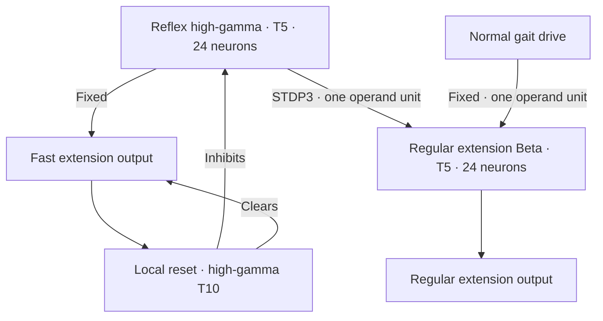

# Direct high-gamma reflex and regular Beta eligibility

Each leg has a **24-neuron high-gamma T5** reflex. It receives two compatible
12-neuron tilt populations and has two direct excitatory motor branches:

The fast output does not wait for Beta. The direct HG → regular Beta connection
uses `rule="STDP3"`, `reward="GAIT_REWARD"`, `reward_type="LTP"`. Pre/post firing
at that connection can create eligibility; later dopaminergic activity can act
on it. There is no intermediate teaching relay or output-to-input republishing.
The Beta is the existing normal knee extension population, not a second reflex
motor Beta.

Both excitatory sources into the regular Beta have `role="operand", units=1`.
This follows the guide's Beta T5 OR starting construction: normal gait or reflex
evidence can recruit extension. Equal canonical units retain both contributions
when a one-neuron gait drive and a 24-neuron reflex converge. Units are not neuron
counts. The builder allocates the receiver's 24 neurons from this relationship.

Learning intentionally adapts reflex recruitment of the normal path. It can
change this initial computation. Eligibility depends on relative firing and
fades; a connection or an accepted reward message alone does not prove useful
learning. LTP follows eligibility's sign, so it is not a promise that every
update strengthens the connection. The fixed fast branch remains available
without reward.

| Population | Classification | TNorm | Neurons each |
| --- | --- | --- | --- |
| Signed tilt evidence | Input | — | 12 |
| REFLEX_*_HG | High-gamma reflex | 5 | 24 |
| Regular KNEE_NEG_BETA | Beta motor | 5 | 24 |
| Other gait motor Betas | Beta motor | 5 | 2 |
| KNEE_REFLEX_EXTEND | Bistable motor output | — | 1 |
| REFLEX_*_OUTPUT_RESET_HG | High-gamma reset | 10 | 1 |
| REFLEX_*_EXTENSION_VETO_HG | High-gamma local veto | 3 | 1 |
| REFLEX_*_ACTIVE | Bistable diagnostic output | — | 1 |

The reflex HG inhibits its own flexion Beta, flexion output and extension-veto
relay at **strength 64**. The veto relay ordinarily conveys the swing state's
inhibition to the regular extension Beta and output. Suppressing that relay
releases normal extension without inhibiting the shared switch or another leg.
The fast output has no gait veto. ACTIVE has no outgoing connections.

The fast output recruits its one-neuron high-gamma T10 reset. That reset inhibits
the same reflex HG and clears both the fast output and ACTIVE at **strength 4**.
It begins from actual output activity. Local excitatory feedback supports the
reflex, while reset ends its activity; continued tilt evidence may recruit
another burst. These strength values are inhibitory reference multipliers,
not TNorms, neuron counts or measured suppression percentages.

| Knee command | Excursion from neutral | Requested speed |
| --- | --- | --- |
| Normal KNEE_NEG | −0.08 rad | 1.5 rad/s |
| KNEE_REFLEX_EXTEND | −0.22 rad | 3.0 rad/s |

The adapter caps speed at the model's maximum. Normal and fast extension do not
add angles. Simultaneous flexion and extension cancel; neural inhibition must
clear flexion. When the fast output clears, normal speed returns on the next
output frame. Python does not choose the supporting leg or time the burst.
The Webots position servo performs physical tracking. A neural burst does not
establish that the joint finished its movement.

| Leg | Excitatory sensory evidence |
| --- | --- |
| FL | Negative roll, positive pitch |
| FR | Positive roll, positive pitch |
| RL | Negative roll, negative pitch |
| RR | Positive roll, negative pitch |

The ENU world has +X forward, +Y left and +Z up. The tilt threshold is 0.15 rad.
Each cue can recruit a leg; this is not a corner selector or strict AND.
Left/front evidence can recruit FL, FR and RL independently. No sensory cue
inhibits another corner. Rear gait relays order normal motor activity after the
front partner; all four reflex paths bypass those relays.

In `walk`, reflexes operate but reward is zero. In `learn`, new upright forward
progress supplies reward to the four direct HG → Beta edges and the four
switch-release inhibitory edges. Correcting a stationary tilt alone is not
rewarded by this progress objective. The reward path is 10 input neurons →
10 high-gamma T10 neurons → 17 dopaminergic T3 neurons, classified as positive
outcome reward. Zero means no reward, not punishment.

Inspect `neuron-telemetry.jsonl` for actual reflex HG, regular Beta, reset and
reward neuron spikes, including zeros. Compare with KNEE_REFLEX_EXTEND,
KNEE_NEG, KNEE_POS and measured joint angles. ACTIVE alone does not prove support.
`observations.jsonl` also records targets and speed limits; a speed limit is not
measured joint speed. Weight observation is still needed to establish updates.

[SWITCH_CHECK.json](SWITCH_CHECK.json) checks static circuit recruitment and
clearing in a local native-cell harness. It does not validate device equivalence,
Webots balance or reward-driven adaptation.
