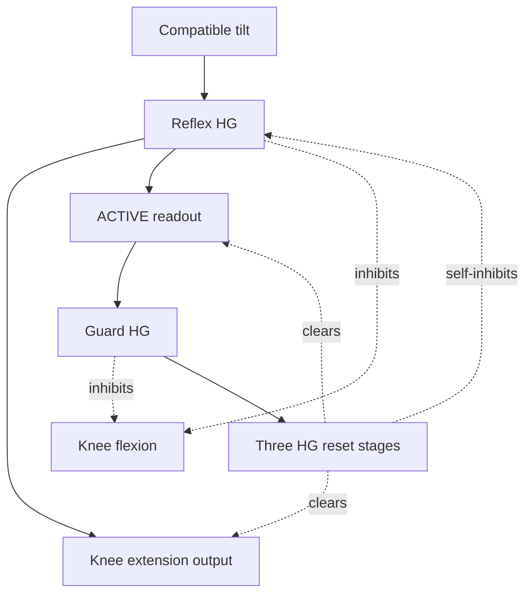

# A local support goal that ends itself

The goal is to support the corner toward which Spot is leaning. Its interaction
with walking is local: inhibit that leg's knee flexion, give knee extension a
short opportunity, then clear the reflex so ordinary walking can resume.

The adapter provides physical evidence. The brain selects the supporting legs,
suppresses their antagonists and terminates the burst. There is no Python burst
timer, leg selector, tilt-to-joint formula or extra phase input.

## Four sensory neurons, four local circuits

The sensor encoder reports roll and pitch above a signed 0.15 rad deadband
(approximately 8.6 degrees). Each channel is one neuron. This coarse encoding
reports direction beyond the threshold; it does not encode tilt magnitude or
angular velocity. The existing gyro is logged for evaluation.

The world explicitly uses ENU, and the bundled Spot's forward direction is local
+X, left is +Y and up is +Z. The installed IMU has no additional rotation.
For this model, negative roll lowers the left side and positive pitch lowers the
front. Check these conventions again if replacing the model or rotating its IMU.

| Reflex | Excitatory tilt evidence | Opposing evidence that vetoes it |
| --- | --- | --- |
| Front-left | Negative roll, positive pitch | Positive roll, negative pitch |
| Front-right | Positive roll, positive pitch | Negative roll, negative pitch |
| Rear-left | Negative roll, negative pitch | Positive roll, positive pitch |
| Rear-right | Positive roll, negative pitch | Negative roll, positive pitch |

This is a shallow local support rule. Either compatible cue can recruit the
reflex; contradictory evidence vetoes it. Pure left tilt supports both left legs.
Left-and-front tilt supplies compatible evidence only to front-left; the other
corners receive a veto. This is not a reusable mathematical AND operator.

The input relays and reflex/guard/reset OPUs all use **High-Gamma T10**. Each
reflex veto and self-reset uses **static inhibitory strength 4**. TNorm is not
inhibitory strength. High-gamma changes the neural pathway; it does not increase
the servo's velocity, torque or permitted position range.

## Burst, local veto and self-inhibition

`REFLEX_FL_HG`, for example, excites `FL_KNEE_NEG` and `REFLEX_FL_ACTIVE`.
It inhibits both `FRONT_LEFT_KNEE_POS_BETA` and `FL_KNEE_POS`. The ACTIVE
readout drives `REFLEX_FL_GUARD_HG`, which continues the flexion veto through
the burst. The same structure exists independently for FR, RL and RR.

The guard excites three successive high-gamma reset populations. The final
population inhibits its own reflex trigger and clears ACTIVE and the knee NEG
output. Only the return to the OPU is marked `role="feedback"`; output-clearing
edges are ordinary inhibition. Every population has an ordinary construction path.

The return path supplies neural delay before cutoff. In the isolated native-cell
checks it produced five-frame extension readouts across six initialization cases.
At the current 64 ms body advance, five applied frames represent 0.32 simulated
seconds. That gives the configured knee servo a plausible interval to traverse
its 0.43 rad flex-to-extension excursion at a 1.5 rad/s speed limit, but physical
load, servo response and competing neural activity can still prevent completion.
This is a measured isolated-circuit result, not a promised hardware pulse width.

There is no ACTIVE-to-trigger excitatory self-latch. One transient tilt cue must
not turn into an autonomous support oscillator. Continued physical evidence can
recruit a later burst after self-inhibition clears. A vanished cue ends without
leaving the extension output latched. See [the isolated check](REFLEX_CHECK.json).

## How this interacts with the gait and STOP

The reflex drives the existing knee NEG output directly and inhibits the existing
knee POS OPU/output. It does not add a heterogeneous excitatory input to the
Beta-to-Beta gait motor relay. The actuator decoder remains unchanged and uses
only each joint's POS/NEG motor outputs, never the REFLEX diagnostics.

The self-reset clears the shared knee NEG output, including any coincident gait
command on it. Subsequent gait activity can recruit it again. The reflex does
not reset A/B, the learned weights or the whole brain. Hip and abduction commands
remain governed by the gait. This is a knee support reflex, not full body balance
control or foot placement planning.

REST and the pending STOP request inhibit the reflex populations and readouts.
REST already clears every local motor output. Stopping therefore includes support
activity. Explicit simulator recovery suspends tilt evidence while restoring and
settling the body; `rhythm` mode also suspends it.

All 66 existing STDP3/LTP gait paths retain their connections and initial settings.
The new reflex paths are static so the burst behavior can be tested before adding
learning to it. Learned gait inhibition can still compete with extension. If a
reflex readout fires but knee NEG does not, inspect that competition in telemetry;
do not conceal it with a controller-side motor override.

## Observe the result

Build the saved graph, wait for READY and run `ab run -ab --env .env learn`.
Press W. The console prints active reflex readouts. Each run records:

- `tilt-inputs.jsonl`: sampled roll/pitch, the four published bits and SDK call
  duration. Queue acceptance is not proof of same-step neural consumption.
- `native-outputs.jsonl`: every received frame, including all four ACTIVE readouts
  and knee outputs. Bistable readouts are not individual neuron spike recordings.
- `observations.jsonl`: the applied outputs, resulting joint/body measurements,
  gyro and output queue depth. The tilt sample follows that frame's body step.
- `summary.json`: reflex entries and active frames by leg, maximum tilt and
  assisted recovery count, alongside gait and reward measurements.

In the existing neuron telemetry window, inspect the relevant `TILT_*_HG`,
`REFLEX_*_HG`, GUARD and RESET populations. Confirm a real burst and its cutoff.
Inspect `GAIT_REWARD_RELAY` and the dopaminergic `GAIT_REWARD` separately: accepted
reward input and ACTIVE output readouts do not prove dopamine neurons fired.

For each tilt event, check that the appropriate knee target becomes negative,
its measured joint position follows, and the body tilt decreases before the
automatic recovery threshold. If the foot is airborne or cannot reach ground,
extension cannot provide support. No contact state is inferred from tilt alone.

Set `reflex.enabled=false` for a comparison without tilt evidence, then start a
new run. Keep other settings and initial neural/body conditions comparable.
Changing the deadband in `config.json` needs a new Run; changing neural rhythm,
connections, strength or reset path requires Design and Build.

Model conventions were checked against the bundled `Spot.proto` / `SpotLeg.proto`
and the Webots R2025a [IMU implementation](https://github.com/cyberbotics/webots/blob/R2025a/src/controller/c/inertial_unit.c)
and [hinge defaults](https://github.com/cyberbotics/webots/blob/R2025a/docs/reference/hingejointparameters.md).
These checks establish sign and neural-circuit consistency. They do not establish
successful balance recovery on Prima-Lux and Webots.
