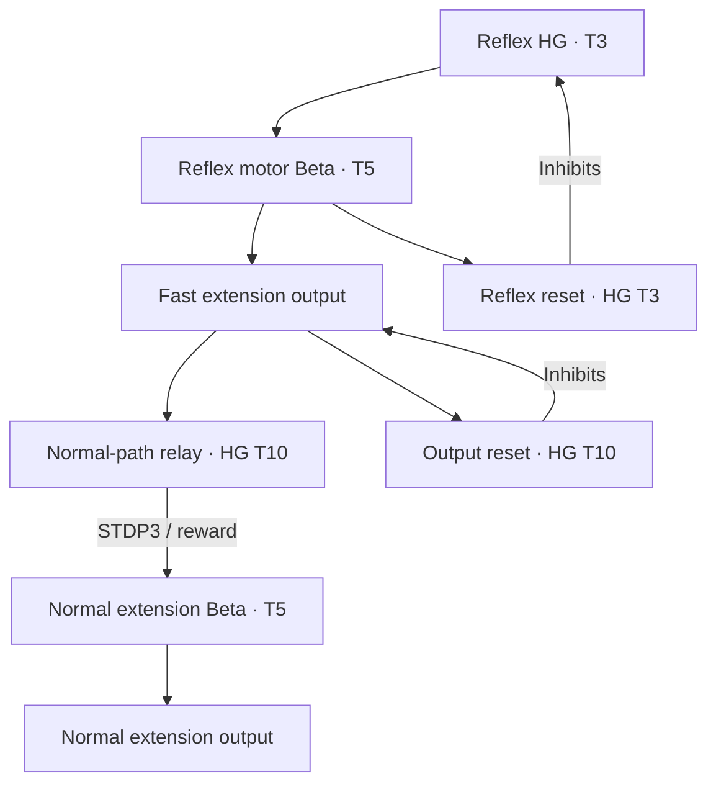

# Fast local reflex and normal motor recruitment

Each leg has a high-gamma T3 reflex with 24 neurons, fed by two compatible
12-neuron tilt populations. It suppresses local flexion and recruits extension
through a dedicated 24-neuron Beta T5. No extra external input is introduced.
The switch and other legs remain independent of this reflex.

The motor output itself supplies the normal-path relay and output reset. Python
does not republish either as a sensor. The one-neuron relays carry an existing
motor decision; they are not substitutes for the 24-neuron sensory reflex.
The normal extension Beta has four neurons, constructed from its phase relay
and normal-path relay, both one-neuron high-gamma sources.

The four NORMAL_RELAY_HG → normal KNEE_NEG_BETA edges use STDP3, GAIT_REWARD and
reward_type LTP. The direct fast branch, local vetoes and resets remain static.
The normal Beta is recruited before learning. STDP3 associates recent source and
receiver activity with later reward; it does not make an inactive pathway fire
without excitation. LTP follows eligibility's sign, so changes can strengthen
or weaken recruitment. This is not a claim of learned anticipation or balance.

| Knee command | Excursion from neutral | Requested speed |
| --- | --- | --- |
| Normal KNEE_NEG | −0.08 rad | 1.5 rad/s |
| KNEE_REFLEX_EXTEND | −0.22 rad | 3.0 rad/s |

The adapter caps speed at the model's maximum. Normal and fast extension do not
add angles. Simultaneous flexion and extension cancel; the neural inhibition
must clear flexion. Fast output clearing restores the normal speed immediately
on the next output frame. No tilt rule, phase selector or host burst timer is
used in this decoding. The Webots position servo still performs physical tracking.

The reflex HG inhibits its own flexion Beta/output and extension-veto relay at
strength 64. That local relay normally carries the swing phase's inhibition to
both extension Betas and the normal extension output. The reflex suppresses it
without inhibiting the shared phase or another corner. Reset, STOP and REST
clearing use strength 4. These are reference multipliers, not TNorms or gains.

Two resets have different jobs: the 24-neuron RESET_HG ends the upstream reflex
and clears ACTIVE; the one-neuron OUTPUT_RESET_HG clears the bistable fast motor
output from its own activity. This prevents a final motor spike from remaining
latched after the upstream reset has ended. Continued evidence can recruit new
bursts. Their duration is neural activity, not a guarantee of joint completion.

| Leg | Excitatory sensory evidence |
| --- | --- |
| FL | Negative roll, positive pitch |
| FR | Positive roll, positive pitch |
| RL | Negative roll, negative pitch |
| RR | Positive roll, negative pitch |

The ENU world has +X forward, +Y left and +Z up. Each cue can recruit a leg;
this is not a corner selector or strict AND. Left/front evidence can recruit
FL, FR and RL independently. No sensory cue inhibits another corner.

In `walk`, reflexes operate but reward is zero. In `learn`, new upright forward
progress supplies reward to both the four teaching edges and four switch-release
inhibitory edges. Correcting a stationary tilt alone is not rewarded by that
existing progress objective. Use neuron/weight telemetry to establish dopamine
firing and actual learning; accepted reward publications are not that evidence.

Inspect KNEE_REFLEX_EXTEND, normal KNEE_NEG, flexion KNEE_POS and actual joint
angles together. ACTIVE alone does not prove support. `observations.jsonl` also
records `joint_target_rad` and `joint_speed_limit_rad_s`; the latter is a command
limit, not measured speed. The console reports `reflex_motors` separately.

The complete-circuit local check in [SWITCH_CHECK.json](SWITCH_CHECK.json) tests
normal-path recruitment and clearing after tilt ends. It does not run Webots
physics or learn weights. Physical correction still needs a device/simulator run.
