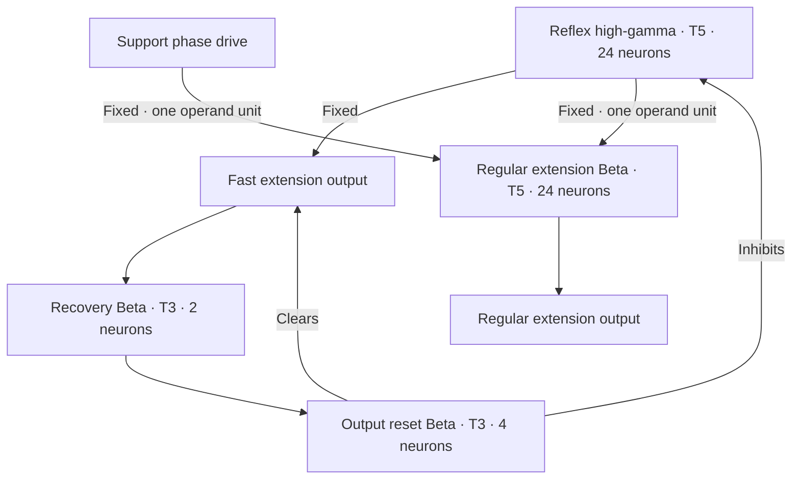

# Fixed high-gamma reflex and regular Beta recruitment

Each leg has a **24-neuron high-gamma T5** reflex. It receives two compatible
12-neuron tilt populations and has two direct excitatory motor branches:

The fast output does not wait for Beta. Both direct reflex branches are static.
Each support PHASE_DRIVE_HG → regular Beta connection is also static.
Reflex activity recruits the regular Beta, but no excitatory connection carries
a learning rule. Local DONE → Beta and Beta → output remain static as well.
There is no intermediate relay or output-to-input republishing.
The Beta is the existing normal knee extension population, not a second reflex
motor Beta.

The three excitatory sources into the regular Beta have `role="operand", units=1`.
This follows the guide's Beta T5 OR starting construction: macro support, local return or reflex
evidence can recruit extension. Equal canonical units retain both contributions
when the two one-neuron support sources and a 24-neuron reflex converge. Units are not neuron
counts. The builder allocates the receiver's 24 neurons from this relationship.

Learning is restricted to the four inhibitory macro release-feedback paths.
The normal excitatory motor paths and the entire reflex circuit remain fixed.
Both reflex motor branches remain available without reward.

| Population | Classification | TNorm | Neurons each |
| --- | --- | --- | --- |
| Signed tilt evidence | Input | — | 12 |
| REFLEX_*_HG | High-gamma reflex | 5 | 24 |
| Regular KNEE_NEG_BETA | Beta motor | 5 | 24 |
| Front / rear swing Betas | Beta motor | 5 | 2 / 4 |
| Other support Betas | Beta motor | 5 | 4 |
| KNEE_REFLEX_EXTEND | Bistable motor output | — | 1 |
| REFLEX_*_RECOVERY_BETA | Beta recovery | 3 | 2 |
| REFLEX_*_OUTPUT_RESET_BETA | Beta reset | 3 | 4 |
| REFLEX_*_EXTENSION_VETO_HG | High-gamma local veto | 10 | 1 |
| REFLEX_*_ACTIVE | Bistable diagnostic output | — | 1 |

The reflex HG inhibits its own flexion Beta, flexion output and extension-veto
relay at **strength 64**. The local veto is driven by retained SWING_READY_HG
and inhibits the regular extension output at strength 64. It does not inhibit
the regular Beta, so reflex input can recruit that Beta during swing. The reflex
suppresses the output veto without changing the shared switch or another leg.
The fast output has no gait veto. ACTIVE has no outgoing connections.

The fast output recruits **RECOVERY_BETA T3 → OUTPUT_RESET_BETA T3**. The latter
inhibits the same reflex HG and clears fast output and ACTIVE at strength 4.
This provides neural integration before clearing instead of the immediate
one-HG return. Continued tilt can recruit later bursts. Strength values are
inhibitory reference multipliers, not TNorms or measured suppression percentages.

| Knee command | Excursion from neutral | Requested speed |
| --- | --- | --- |
| Normal KNEE_NEG | −0.08 rad | 1.5 rad/s |
| KNEE_REFLEX_EXTEND | −0.22 rad | 3.0 rad/s |

The adapter caps speed at the model's maximum. Normal and fast extension do not
add angles. Simultaneous flexion and extension cancel; neural inhibition must
clear flexion. When the fast output clears, normal speed returns on the next
output frame. Python does not choose the supporting leg or time the burst.
The Webots position servo performs physical tracking. A neural burst does not
establish that the joint finished its movement.

| Leg | Excitatory sensory evidence |
| --- | --- |
| FL | Negative roll, positive pitch |
| FR | Positive roll, positive pitch |
| RL | Negative roll, negative pitch |
| RR | Positive roll, negative pitch |

The ENU world has +X forward, +Y left and +Z up. The tilt threshold is 0.08 rad; each body advance is 32 ms.
Each cue can recruit a leg; this is not a corner selector or strict AND.
Left/front evidence can recruit FL, FR and RL independently. No sensory cue
inhibits another corner. Rear gait handoff follows the front return pathway; all four reflex paths bypass those relays.

In `walk`, reflexes operate but reward is zero. In `learn`, new upright forward
progress supplies reward to only the four switch-release inhibitory edges.
Those four plastic connections use STDP3/LTP. Every excitatory connection and
every reflex connection stays static.
Correcting a stationary tilt alone is not
rewarded by this progress objective. The reward path is 10 input neurons →
10 high-gamma T10 neurons → 17 dopaminergic T3 neurons, classified as positive
outcome reward. Zero means no reward, not punishment.

Inspect `neuron-telemetry.jsonl` for actual reflex HG, regular Beta, reset and
reward neuron spikes, including zeros. Compare with KNEE_REFLEX_EXTEND,
KNEE_NEG, KNEE_POS and measured joint angles. ACTIVE alone does not prove support.
`observations.jsonl` also records targets and speed limits; a speed limit is not
measured joint speed. Weight observation is still needed to establish updates.

[SWITCH_CHECK.json](SWITCH_CHECK.json) checks static circuit recruitment and
clearing in a local native-cell harness. It does not validate device equivalence,
Webots balance or reward-driven adaptation.
