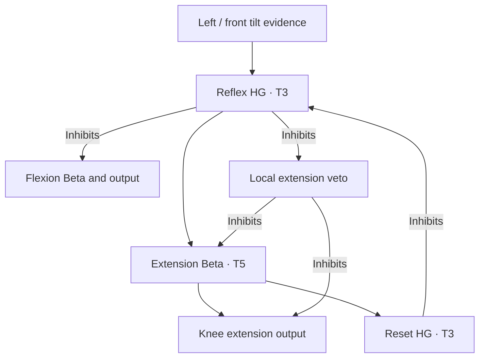

# Independent local support reflexes

Each leg has a high-gamma T3 reflex with 24 neurons. It acts on that leg's knee
without requesting a switch state or sending a corrective motor command through
Python. The Webots adapter reads roll/pitch and publishes four signed sensory
populations, each containing 12 neurons. These are four measured signals, not
48 separate sensors or extra phase/progress commands.

For the front-left leg:

HG also has an excitatory return to itself to bridge sensory-event gaps. The
extension Beta's activity recruits the reset, which ends that reflex drive.
Existing motor inhibition clears the actuator output; the reset does not impose
a separate early motor cutoff. ACTIVE is a diagnostic with no outgoing edge.

The gait extension Beta and reflex extension Beta both excite the same KNEE_NEG
output. The reflex is therefore a separate neural route through a Beta before
the output. It does not enlarge the gait Beta's excitatory source population.

The local extension-veto relay normally carries the swing state's inhibition to
both extension Betas and their output. The reflex suppresses this local relay
while suppressing flexion. It never inhibits the shared state relay or another
leg. Flexion/veto suppression uses strength 64; reset and REST clearing use 4.
These are reference-strength multipliers, not percentages or TNorm values.

| Leg | Excitatory sensory evidence |
| --- | --- |
| FL | Negative roll, positive pitch |
| FR | Positive roll, positive pitch |
| RL | Negative roll, negative pitch |
| RR | Positive roll, negative pitch |

The world uses ENU (+X forward, +Y left, +Z up). Each cue can recruit a leg; this
is not a corner selector or strict AND gate. Left roll recruits FL and RL.
Left/front evidence can recruit FL, FR and RL independently. No sensory cue
inhibits another corner.

| Local population | Rhythm | TNorm | Neurons |
| --- | --- | --- | --- |
| Reflex | High-gamma | 3 | 24 |
| Extension motor | Beta | 5 | 24 |
| Reset | High-gamma | 3 | 24 |
| Gait extension-veto relay | High-gamma | 3 | 1 |

The 1-neuron relay only carries the gait veto; it is not the sensory reflex.
Both 12-neuron tilt sources construct the 24-neuron reflex. The builder calculates
the following populations. No proprietary construction equations are needed to
edit these public relationships.

`tilt-inputs.jsonl` records accepted sensory publications; `native-outputs.jsonl`
records outputs; `observations.jsonl` joins the applied outputs with joint/body
measurements. ACTIVE alone does not prove extension or physical support. Check
KNEE_POS/KNEE_NEG and joint angles. Fresh evidence can retrigger a reflex; it is
not a one-use latch. Recovery suspends tilt publication while repositioning.

The full-circuit local checks are in [SWITCH_CHECK.json](SWITCH_CHECK.json).
They do not measure hardware latency or establish physical balance.
